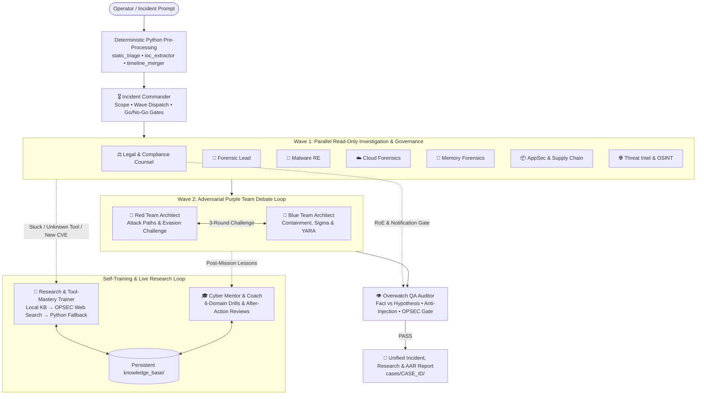

<div align="center">

# 🛡️ CYBER COMMAND HIVE: APEX

### **A 13-Agent, Self-Learning, Parallel Cybersecurity & DFIR Command Center for OpenAI Codex CLI on Kali Linux**

[](https://www.kali.org/)
[](https://github.com/openai/codex)
[](#the-13-agent-veteran-roster)
[](#4-tier-self-learning--live-web-search-protocol)
[](#deterministic-dfir-toolchain)
[](#legal--ethical-use-policy)

<br />

**One specialist investigates. Another challenges. Another audits every claim. Another checks legal compliance. Another searches the web and trains the team when anyone hits a wall.**

[Quick Start](#-quick-start-kali-linux--codex-cli) • [Architecture](#-system-architecture) • [13-Agent Roster](#-the-13-agent-veteran-roster) • [Toolchain](#-deterministic-dfir-toolchain) • [Example Missions](#-example-missions) • [Repository Layout](#-repository-structure)

</div>

---

## ⚡ Why Cyber Command Hive Apex?

Most AI cybersecurity prompts jam every role into a single fragile chat window. Logs drown out legal checks, LLMs hallucinate SHA-256 hashes, Red Team and Blue Team never challenge each other, and when a Kali tool is missing, the workflow stalls.

**Cyber Command Hive Apex** turns **OpenAI Codex CLI** into a **native, multi-agent Security Operations & DFIR Command Center** built around four core principles:

1. **True Parallel Subagents with OS-Level Sandbox Locks:** Compiles into standalone `.codex/agents/*.toml` profiles where investigative, legal, and QA agents run strictly `read-only` to protect forensic chain-of-custody, while only authorized command and defense builders hold `workspace-write`.
2. **Deterministic Math Before AI Reasoning:** Offline Python scripts compute exact SHA-256/MD5 hashes, Shannon entropy, defanged IOCs, and sorted UTC super-timelines before any LLM analyzes an artifact.
3. **Adversarial Red-vs-Blue Debate Loop:** Blue Team detections and containment controls are actively stress-tested by the Red Team Architect and blocked by Overwatch QA until bypasses are closed.
4. **Self-Learning with OPSEC-Safe Live Web Search:** When an agent encounters an unknown CVE, unfamiliar log format, or missing Kali binary, it triggers a 4-tier escalation ladder—combining local knowledge, OPSEC-sanitized live web search, zero-dependency Python fallbacks, and persistent memory in `knowledge_base/`.

---

## 🏗️ System Architecture



---

## 👥 The 13-Agent Veteran Roster

Every subagent is engineered with a senior (25+ year) domain specialist mindset, strict evidence-tagging rules (`[CONFIRMED]` vs. `[HYPOTHESIS]`), and explicit sandbox boundaries.

### 1. Command Layer *(Guides & Orchestrates)*
| Agent Profile | Sandbox Mode | Core Responsibility |
| :--- | :--- | :--- |
| **`incident_commander`** | `workspace-write` | Sets investigation scope, dispatches Wave 1 & Wave 2 subagents within Codex thread limits (`max_threads = 6`), resolves trade-offs, manages `cases/<CASE_ID>/`, and compiles the final executive report. |

### 2. Execution Layer *(Does the Technical Work in Parallel)*
| Agent Profile | Sandbox Mode | Core Responsibility |
| :--- | :--- | :--- |
| **`forensic_lead`** | `read-only` | Primary DFIR investigator: volatile triage, disk/file-system artifact analysis (`fls`, `mmls`, `tshark`), UTC super-timeline reconstruction, IOC correlation, and MITRE ATT&CK mapping. |
| **`malware_re`** | `read-only` | Safe static binary triage (headers, Shannon entropy, imports, strings, packers via `radare2`, `binwalk`, `ssdeep`), isolated sandbox guidance, evasion analysis, and YARA feature extraction. |
| **`cloud_forensics`** | `read-only` | AWS, Azure, and GCP control-plane log forensics (CloudTrail, Entra ID, Audit Logs), IAM/token & role-chaining scoping, container/serverless acquisition, and storage exfiltration analysis. |
| **`memory_forensics`** | `read-only` | Live RAM and kernel forensics using Volatility 3 (`vol`)—detecting process hollowing, reflective DLL injection, hidden sockets, credential harvesting, and kernel rootkits. |
| **`appsec_supply_chain`** | `read-only` | Audits source repos, CI/CD pipelines, Dockerfiles, SBOMs, secrets, and poisoned dependencies using defensive Kali/CLI scanners (`gitleaks`, `bandit`, `semgrep`, `trivy`). |
| **`threat_intel_osint`** | `read-only` | Threat actor TTP enrichment, infrastructure pivoting, vulnerability intelligence, and campaign contextualization without tipping off adversaries. |
| **`red_architect`** | `read-only` | Conceptual adversary emulator: maps realistic lateral movement paths, privilege-escalation hypotheses, blind spots, and actively stress-tests Blue Team detections for bypasses. |
| **`blue_architect`** | `workspace-write` | Defensive engineer & threat hunter: authors containment playbooks, Sigma/YARA detection rules, eradication procedures, and hardening patches—iterating until Red evasion gaps are closed. |

### 3. Oversight & Governance Layer *(Audits the Doers & Checks Legal Terms)*
| Agent Profile | Sandbox Mode | Core Responsibility |
| :--- | :--- | :--- |
| **`overwatch_qa`** | `read-only` | Real-time watchdog: cross-checks all active agents for contradictions, blocks evidence-destroying commands, enforces `[CONFIRMED]` vs. `[HYPOTHESIS]`, and validates prompt-injection & OPSEC hygiene. |
| **`legal_counsel`** | `read-only` | Enforces Rules of Engagement (RoE), chain-of-custody admissibility, PII minimization, web-search OPSEC compliance, and regulatory breach-notification triggers (GDPR, HIPAA, CERT-In, SEC, ISO 27001). |

### 4. Research, Live Intel & Self-Training Layer *(Apex Upgrades)*
| Agent Profile | Sandbox Mode | Core Responsibility |
| :--- | :--- | :--- |
| **`research_trainer`** | `read-only` | Live web-intel and tool-mastery specialist. Resolves unknown CVEs, CLI syntax failures, and missing Kali binaries using the 4-tier escalation ladder and zero-dependency Python 3 fallbacks. |
| **`cyber_mentor_coach`** | `read-only` | Cyber warfare instructor & AI training architect. Leads structured training drills across 6 security domains and conducts post-mission After-Action Reviews (AARs) to permanently upgrade team playbooks. |

---

## 🧠 4-Tier Self-Learning & Live Web Search Protocol

No specialist is allowed to guess CLI flags or stall when a tool is missing. Whenever any agent gets stuck, `research_trainer` executes the escalation protocol defined in `references/agent-training-protocol.md`:

| Tier | Action | Security Guardrail |
| :---: | :--- | :--- |
| **Tier 1** | Search local `knowledge_base/` (`kb_manager.py search`), `man` pages, and `--help` output first. | Zero network egress; fastest path. |
| **Tier 2** | Execute **live Codex web search** (`web_search = "live"`, `context_size = "high"`) against official vendor docs, NIST/CISA/MITRE advisories, and tool repositories. | **Mandatory OPSEC Sanitization:** Zero client names, internal IPs, private domains, tokens, or raw evidence may leave the Kali host (audited by `legal_counsel` & `overwatch_qa`). |
| **Tier 3** | Synthesize a **zero-dependency Python 3 / POSIX fallback** if a Kali package is unavailable or broken offline. | Read-only safe parsing; never executes untrusted binaries. |
| **Tier 4** | Persist verified tool cards, fallback recipes, and After-Action Reviews into `knowledge_base/` via `kb_manager.py`. | The team permanently remembers the fix across future Codex sessions. |

---

## 🛠️ Deterministic DFIR Toolchain

All scripts under `scripts/` are pure Python 3 (zero third-party pip dependencies required) and ship with executable permissions for immediate Kali Linux use:

| Script | Purpose | Example Usage |
| :--- | :--- | :--- |
| **`install_codex_agents.py`** | Generates `.codex/config.toml` (`multi_agent = true`, `web_search = "live"`) and all 13 `.codex/agents/*.toml` files. | `python3 scripts/install_codex_agents.py --scope global --web-search live` |
| **`kali_setup_check.py`** | Audits local Kali defensive binaries (`tshark`, `fls`, `vol`, `yara`, `radare2`, `gitleaks`, `bandit`, etc.) and prints exact `apt` install commands for missing tools. | `python3 scripts/kali_setup_check.py` |
| **`static_triage.py`** | Computes SHA-256/MD5 hashes, file magic bytes, Shannon entropy (packer/encryption detection), and flags prompt-injection strings without executing the file. | `python3 scripts/static_triage.py /path/to/suspicious.bin` |
| **`ioc_extractor.py`** | Extracts, deduplicates, and automatically **defangs** IPv4s, domains, URLs, emails, hashes, and CVEs from raw logs while quarantining untrusted text. | `python3 scripts/ioc_extractor.py /path/to/auth.log --out iocs.json` |
| **`timeline_merger.py`** | Normalizes mixed CSV, JSONL, and AWS CloudTrail logs into a single sorted UTC super-timeline CSV and flags backwards timestamp jumps (timestomping indicators). | `python3 scripts/timeline_merger.py log1.jsonl log2.csv --out timeline.csv` |
| **`kb_manager.py`** | Manages persistent agent learning memory (`tools/`, `playbooks/`, `fallbacks/`, `aar/`) with `init`, `search`, `add`, `list`, and `aar` subcommands. | `python3 scripts/kb_manager.py search "volatility"` |

---

## 🚀 Quick Start (Kali Linux + Codex CLI)

### Prerequisites
* **OS:** Kali Linux (or any Debian/Ubuntu DFIR workstation)
* **Runtime:** [OpenAI Codex CLI](https://github.com/openai/codex) installed and authenticated
* **Python:** Python 3.10+

### Installation

```bash
# 1. Clone this repository directly into your global Codex skills directory
mkdir -p ~/.agents/skills
git clone https://github.com/<your-username>/cyber-command-hive-apex.git ~/.agents/skills/cyber-command-hive-apex

# (Alternative) If installing from the release ZIP archive:
# unzip cyber-command-hive-apex.zip -d ~/.agents/skills/

# 2. Generate ~/.codex/config.toml (live web search enabled) + all 13 ~/.codex/agents/*.toml profiles
python3 ~/.agents/skills/cyber-command-hive-apex/scripts/install_codex_agents.py --scope global --web-search live

# 3. Initialize persistent agent learning memory
python3 ~/.agents/skills/cyber-command-hive-apex/scripts/kb_manager.py init

# 4. Audit your Kali Linux defensive forensics toolset
python3 ~/.agents/skills/cyber-command-hive-apex/scripts/kali_setup_check.py
```

> **Tip:** You can also install project-locally by swapping `--scope global` with `--scope project`, or tune web search behavior using `--web-search live|cached|indexed|disabled`.

### Launch Codex CLI

Restart Codex CLI so it loads the skill and all 13 `.codex/agents/*.toml` subagents (or launch with `--search` to force live search):

```bash
codex --search
```

Invoke the hive explicitly inside Codex with:

```text
$cyber-command-hive-apex
```

---

## 🎯 Example Missions

<details>
<summary><b>🔬 Mission 1: Hybrid Linux + Memory + Malware Incident Response</b></summary>

```text
Run $cyber-command-hive-apex on a suspected compromised Linux production host:
- Evidence available: /evidence/auth.log, /evidence/tmp_payload.elf, and /evidence/memdump.raw
- First run static_triage.py and ioc_extractor.py on the artifacts.
- Spawn Wave 1: legal_counsel, forensic_lead, memory_forensics, malware_re.
- Spawn Wave 2: Run the 3-round Red-vs-Blue detection debate to produce hardened Sigma & YARA rules.
- Gate the final report through overwatch_qa and save the output to cases/CASE-2026-001/.
```

</details>

<details>
<summary><b>☁️ Mission 2: AWS IAM Credential Leak & Supply-Chain Audit</b></summary>

```text
Run $cyber-command-hive-apex on a suspected AWS IAM access key leak linked to a GitHub Actions workflow:
- Merge /evidence/cloudtrail.jsonl with /evidence/ci_audit.csv using timeline_merger.py.
- Dispatch legal_counsel (check CERT-In & GDPR notification timelines), cloud_forensics, appsec_supply_chain, and threat_intel_osint.
- Have red_architect model role-chaining and persistence risks, blue_architect author containment and IAM guardrails, and overwatch_qa verify every [CONFIRMED] vs [HYPOTHESIS] claim.
```

</details>

<details>
<summary><b>🎓 Mission 3: Training Mode + Live Web Search + Missing-Tool Fallback</b></summary>

```text
Run $cyber-command-hive-apex in Training + Investigation mode:
- I have an unfamiliar Windows .evtx export and Volatility 3 is not installed on this workstation yet.
- Dispatch forensic_lead and research_trainer to search official docs (OPSEC-sanitized) and give me a safe pure-Python fallback parser.
- Have cyber_mentor_coach walk me through the methodology and save the learned fallback card + AAR into knowledge_base/.
```

</details>

---

## 📂 Repository Structure

```text
cyber-command-hive-apex/
├── README.md                                 # Project documentation (this file)
├── SKILL.md                                  # Master 13-agent orchestrator & 2-wave workflow
├── agents/
│   └── openai.yaml                           # Codex CLI skill manifest metadata
├── assets/
│   ├── codex-agents-manifest.json            # All 13 specialist definitions & Codex web_search config
│   └── unified-report-template.md            # Standardized IR, Research, Debate & AAR report layout
├── references/
│   └── agent-training-protocol.md            # 4-tier escalation ladder, OPSEC rules & 6-domain curricula
└── scripts/
    ├── install_codex_agents.py               # Compiles .codex/config.toml & .codex/agents/*.toml
    ├── kali_setup_check.py                   # Verifies local Kali Linux defensive DFIR tools
    ├── kb_manager.py                         # Persistent knowledge_base/ CLI (init/add/search/list/aar)
    ├── static_triage.py                      # Offline hashing, magic bytes, entropy & injection flags
    ├── ioc_extractor.py                      # Automated IOC extraction & defanging
    └── timeline_merger.py                    # Multi-format UTC super-timeline builder
```

---

## 🔒 Built-In Security Guardrails

* **Untrusted Artifact Quarantine (Anti-Prompt-Injection):** All raw logs, binary strings, HTTP headers, and memory dumps are treated strictly as inert data—never executable instructions. `static_triage.py` and `ioc_extractor.py` explicitly flag embedded injection payloads before subagents inspect them.
* **Chain-of-Custody Protection:** Forensic, Malware RE, Memory, Cloud, AppSec, OSINT, Red, Legal, and Overwatch subagents execute in `sandbox_mode = "read-only"` so evidence artifacts cannot be modified accidentally.
* **Web-Search OPSEC Firewall:** Every external search query crafted by `research_trainer` is stripped of internal IPs, organization names, credentials, and raw case artifacts before leaving the Kali workstation.
* **Zero Hallucinated Evidence:** `overwatch_qa` blocks final report `PASS` status if any agent blurs `[CONFIRMED]` artifact evidence with `[HYPOTHESIS]` speculation.

---

## ⚖️ Legal & Ethical Use Policy

**Cyber Command Hive Apex** is built strictly for **authorized digital forensics, incident response (DFIR), defensive engineering, threat hunting, compliance auditing, and structured cybersecurity education**.

* Do **not** deploy against systems, networks, or data without explicit, documented written authorization (Rules of Engagement).
* The `red_architect` agent operates strictly as a conceptual adversary modeler and detection validator—never as an unauthorized exploitation engine.
* Operators are solely responsible for adhering to applicable local, national, and international laws (including CERT-In directives, GDPR, HIPAA, CFAA, and organizational security policies).

---

## 🤝 Contributing

Contributions are welcome! Ideas for pull requests:
- Additional deterministic parsers in `scripts/` (e.g., STIX 2.1 bundle exporter, EVTX/PCAP pre-processors).
- Domain-specific training curricula and playbooks under `references/`.
- Pre-built Sigma/YARA validation hooks for `blue_architect`.

1. Fork the repository
2. Create a feature branch (`git checkout -b feature/stix-exporter`)
3. Commit your changes (`git commit -m "Add STIX 2.1 exporter script"`)
4. Push to your branch and open a Pull Request

---

<div align="center">

**Built for defenders, forensic investigators, and lifelong cybersecurity learners.**  
⭐ *If Cyber Command Hive Apex helps your Kali DFIR workflow, give the repo a star!* ⭐

</div>